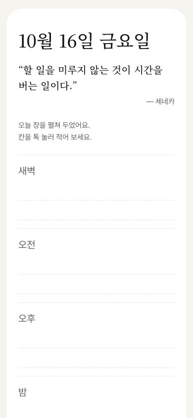
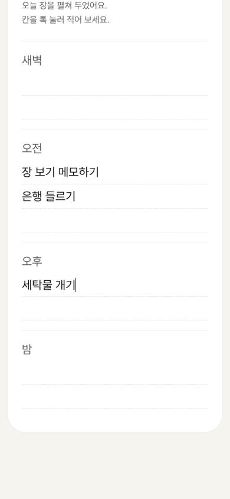
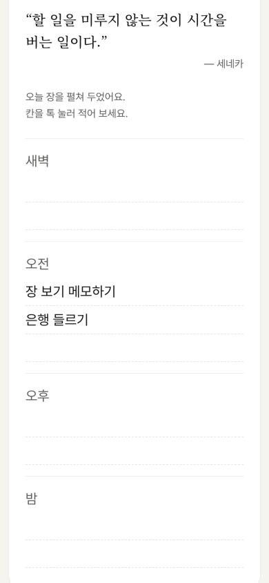
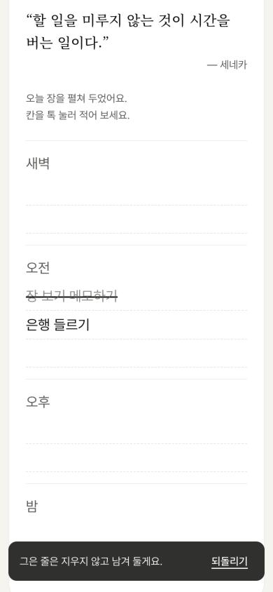
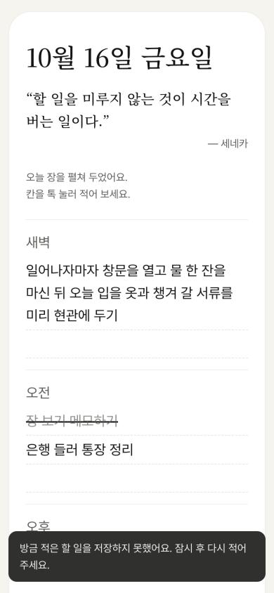
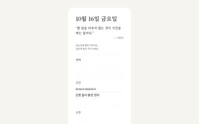

# Review — 01 · F1 첫 장에 적고 긋기

> Vibe Studio · build-check · 최신 점검이 위에 있어요

## 2026-10-16 · 목표: UI 구현 · 걸어본 플로우: F1

**한 줄 결론:** 목표 순간까지 막힘 없이 가요. 어긋난 곳 1개, 위험 없음.

> 만든 대화와 같은 대화에서 점검했어요. 새 대화에서 다시 부르면 더 깐깐하게 볼 수 있어요.

### 걸어본 길
폰 폭(390px)에서, 브라우저에 저장된 걸 모두 지운 처음 상태로 시작했어요.

| 단계 | 화면 | 결과 | 스크린샷 |
|:--:|------|------|------|
| ① | 오늘 장 (처음 열기) | 통과 — 날짜·오늘의 한 줄·지은이·안내 한 줄·4칸 |  |
| ② | 오늘 장 · 적는 중 | 통과 — 누른 칸에 바로 입력줄, 엔터로 적고 다음 줄 |  |
| ③ | 오늘 장 · 적어 둔 할 일 | 통과 |  |
| ④ | 첫 줄을 그은 순간 | 통과 — 목표 순간 도착. 펜 선이 그어진 채 제자리에 흐리게 남고, 한마디와 [되돌리기] |  |
| — | 저장 실패 (`?save=fail`) | 통과 — 안내가 뜨고 적은 글은 화면에 남음 |  |
| — | 넓은 화면 (1280px) | 통과 — 가운데 폰 폭 한 장 |  |

확인 기준 13개 중 13개 통과 · 콘솔 에러 없음(새 탭에서 다시 확인) · 넓은 화면 괜찮음

함께 건드려 본 예외: 빈 채로 엔터(입력 닫힘) · 같은 할 일 두 번(그대로 둠) · 아주 긴 할 일(잘리지 않고 줄 바꿈, 펜 선도 줄마다) · 잘못 그음(다시 톡/되돌리기로 풀림) · 길게 눌러 지우기(묻지 않고 지우고 되돌리기) · 새로고침 뒤에도 적은 것·그은 줄 유지 · 첫 긋기 한마디는 새로고침 뒤에도 다시 안 나옴

### 문제
| # | 종류 | 어디서 | 무엇이 | 고치려면 (build-slice에 그대로) |
|:--:|------|--------|--------|------|
| 1 | 어긋남 | ② 적는 중, 엔터 없이 앱을 닫거나 새로고침 | 오후 칸에 "세탁물 개기"를 적다가 엔터 없이 새로고침하면 글이 사라져요. FLOWS F1 ② 예외는 "적던 글이 있으면 그대로 적힌 것으로 저장"  | "입력줄에 적던 글이 있을 때 엔터 없이 앱을 닫거나 새로고침해도, 다시 열면 그 칸에 할 일로 적혀 있게 해줘 (FLOWS F1 ② 예외)" |

### 다듬으면 좋을 것
- 실제 휴대폰 손가락으로 길게 누르기는 확인하지 못했어요(브라우저에서는 누르는 동작을 흉내 내 확인). 폰으로 열어 한 번 눌러보면 좋아요
- 첫 긋기 한마디와 지우기 안내가 5초 뒤에 사라져요. [되돌리기]를 누르기에 짧지 않은지 써보며 봐 주세요
- 칸 사이 구분선과 빈 노트 선이 흰 종이 위에서 꽤 흐려요. DESIGN 값 그대로라 문제는 아니고, 폰 밝기를 낮추면 칸 경계가 잘 안 보일 수 있어요

### 기획과 달라진 점 (→ userflow-generator)
- 노트 한 장이 폰 폭이라 날짜·오늘의 한 줄 글씨를 DESIGN 값보다 작게 함(날짜 36px, 한 줄 20px), 장 안쪽 여백은 폰 24px (LOG 조각 1)
- 칸 이름이나 빈 노트 선을 누르면 입력줄이 열림 — 적어 둔 할 일을 누르면 긋기라서 (LOG 조각 2)
- 저장 실패 안내·첫 긋기 한마디·지우기 안내는 화면 아래 어두운 띠로 잠깐 보임 (LOG 조각 2·3)
- 데스크톱에서는 오른쪽 클릭으로도 [고치기] [지우기] 메뉴가 열림, 고치다가 글을 다 비우면 원래 글을 그대로 둠 (LOG 조각 4)
- 화면 문구에서 "(임시)" 표시가 붙었던 두 문구("그은 줄은 지우지 않고 남겨 둘게요.", "할 일을 지웠어요.")를 그대로 씀 — 확정할지 정해 주세요

### 다음
1. 문제 1을 build-slice로 고치기 (지금 고칠지 다음에 할지 정해 주세요)
2. userflow-generator로 "F1 만들었어, 달라진 점 반영해줘" — F1 상태가 UI 구현으로 바뀌어요
3. 다음 작업 묶음은 build-spec으로 (F2 아침에 새 장 펼치기를 먼저 그려야 해요)
