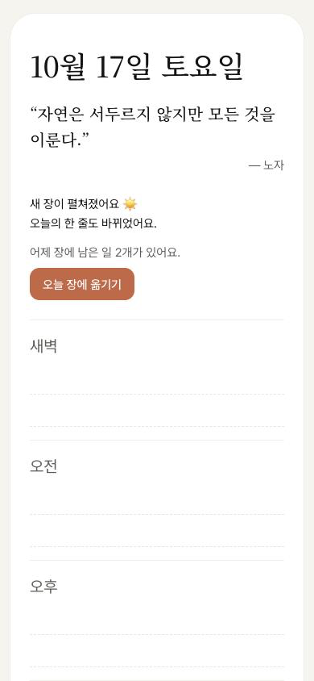
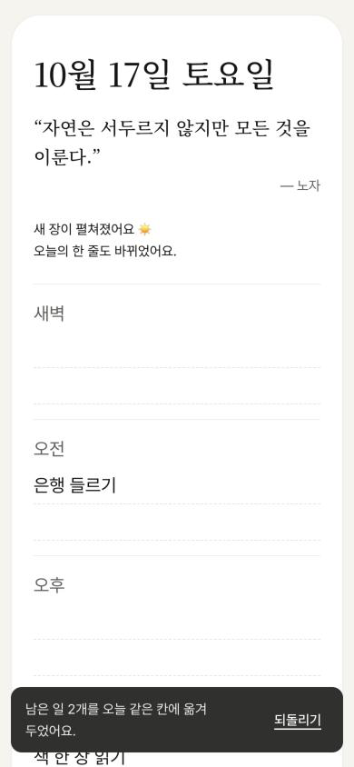
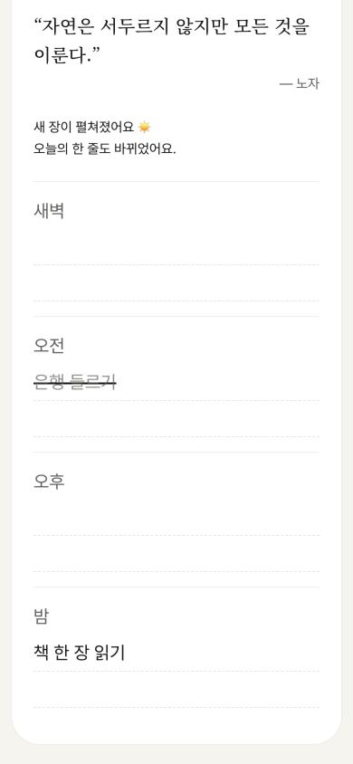
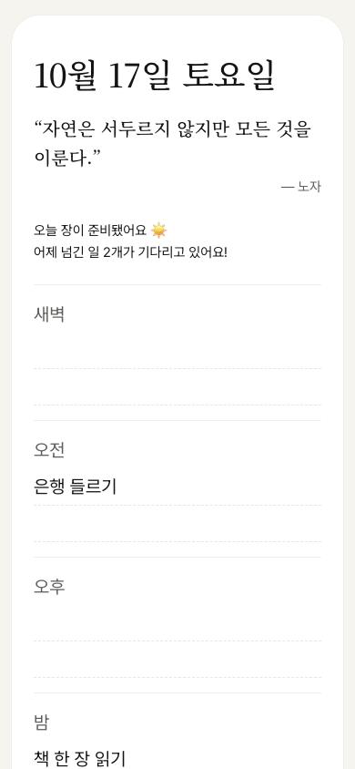

# Review — 02 · F2 아침에 새 장 펼치기

> Vibe Studio · build-check · 최신 점검이 위에 있어요

## 2026-10-16 · 목표: UI 구현 · 걸어본 플로우: F2

**한 줄 결론:** 목표 순간까지 막힘 없이 가요. 막힘·어긋남·위험 없음.

> 만든 대화와 같은 대화에서 점검했어요. 새 대화에서 다시 부르면 더 깐깐하게 볼 수 있어요.

### 걸어본 길
폰 폭(390px)에서 브라우저 데이터를 지운 처음 상태로 시작했어요. 첫날(`?now=2026-10-16T09:00`)에 할 일 3개를 손으로 적고 하나를 그은 뒤, 다음 날 아침(`?now=2026-10-17T07:30`)에 다시 열었어요. F3(밤에 보내기)가 아직 없어서 실제 사용자처럼 "남은 일 옮기기" 길로 걸었고, 보낸 일 받기는 `&sent=1` 흉내로 따로 봤어요.

| 단계 | 화면 | 결과 | 스크린샷 |
|:--:|------|------|------|
| ① | 새 장 (아침 첫 열기) | 통과 — 새 날짜, 바뀐 한 줄, 인사, "어제 장에 남은 일 2개가 있어요." [오늘 장에 옮기기] |  |
| ① | 옮긴 뒤 | 통과 — 그은 일은 빼고 남은 2개만 같은 칸으로, 안내와 [되돌리기] |  |
| ② | 이어서 쓰기 | 통과 — 목표 순간 도착. 옮겨 온 "은행 들르기"를 그음, 첫 긋기 한마디는 다시 안 나옴 |  |
| — | 넘긴 일 받기 (`&sent=1`) | 통과 — 같은 칸 맨 위, "어제 넘긴 일 2개가 기다리고 있어요!" |  |
| — | 넓은 화면 (1280px) | 통과 — 가운데 폰 폭 한 장 |  |

확인 기준 12개 중 12개 통과 · 콘솔 에러 없음(새 탭에서 확인) · 넓은 화면 괜찮음 · 비밀 키 없음

함께 건드려 본 예외: 며칠 만에 옴("지난 장에서 넘긴 일", "지난 장에 남은 일") · 어제 장은 그대로 남음 · 브라우저 데이터를 지우면 F1 첫 장처럼 · 옮기기 되돌리기 · 넘긴 일 지우기와 되돌리기 · 옮기지 않고 하나 적으면 남은 일 줄이 접힘 · 저장이 막힌 채 옮기기 · 자정 1분 전에 켜 두고 70초 지나도 장 그대로 → 돌아오면 새 장 · 자정 직전에 엔터 없이 적던 "알람 맞추기"도 돌아온 뒤 남은 일 줄로 챙겨짐

확인 못 함: 실제 폰에서 다른 앱에 갔다 돌아오는 동작. 이 브라우저 창은 탭을 바꿔도 "가려짐"으로 잡히지 않아서 "돌아왔다"는 신호를 직접 보내 확인했어요.

### 문제
막힘·어긋남·위험 없음

### 다듬으면 좋을 것
- 하루를 옮기지 않고 넘기면 그 전 장에 남은 일은 다시 챙기지 않아요. 예: 10/20에 남은 "알람 맞추기"를 10/21에 옮기지 않으면 10/22엔 한 줄이 안 보여요. FLOWS대로("바로 전에 펼친 장 하나만")지만, F3·F4를 그릴 때 이게 괜찮은지 한 번 정하면 좋아요
- 아침 인사 "어제 넘긴 일 2개가 기다리고 있어요!"는 넘긴 일을 다 긋거나 지운 뒤에도 그날 내내 그대로예요
- [오늘 장에 옮기기] 버튼의 흰 글씨와 테라코타 바탕 대비가 3.9:1로, 작은 글씨 권장(4.5:1)보다 조금 낮아요. DESIGN 값 그대로라 문제는 아니에요

### 기획과 달라진 점 (→ userflow-generator)
- 새 장은 그 날 처음 열 때 빈 장으로 바로 저장해 둠 — 그래야 "바로 전에 펼친 장"을 알 수 있음 (LOG 조각 1)
- 아침 인사는 F1 안내보다 진한 먹색 글씨 (LOG 조각 1)
- [오늘 장에 옮기기]는 이 화면의 주요 행동이라 테라코타 버튼, 옮긴 일은 넘겨받은 일보다 위(칸 맨 위)에 놓임 (LOG 조각 3)
- 남은 일 줄은 적거나 그을 때뿐 아니라 고치거나 지워도 접힘 (LOG 조각 3)
- 남은 일 줄은 바로 전 장에 남은 일만 봄 (LOG 조각 4)

### 다음
1. userflow-generator로 "F2 만들었어, 달라진 점 반영해줘" — 코드를 읽고 F2 상태를 정해요
2. 다음 플로우는 F3 남은 일 내일로 보내기 — 그리고 나면 `&sent=1` 흉내를 진짜 보내기로 바꿔요
