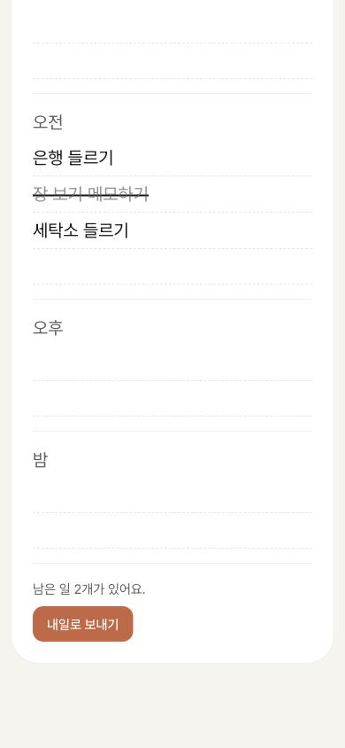
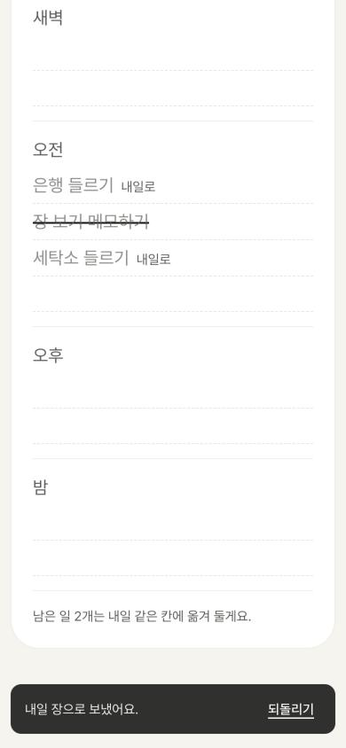
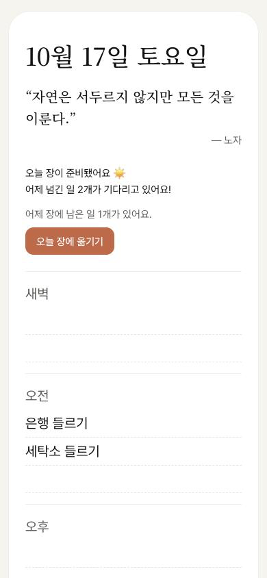

# Review — 03 · F3 남은 일 내일로 보내기

> Vibe Studio · build-check · 최신 점검이 위에 있어요

## 2026-10-16 · 목표: UI 구현 · 걸어본 플로우: F3, F2

**한 줄 결론:** 목표 순간까지 막힘 없이 가요. 어긋난 곳 1개, 위험 없음.

> 만든 대화와 같은 대화에서 점검했어요. 새 대화에서 다시 부르면 더 깐깐하게 볼 수 있어요.

### 걸어본 길
폰 폭(390px), 브라우저 데이터를 지운 처음 상태. 아침 9시에 할 일 3개를 손으로 적고 하나를 그은 뒤, 밤 10시에 다시 열어 보냈고, 다음 날 아침에 받아 봤어요.

| 단계 | 화면 | 결과 | 스크린샷 |
|:--:|------|------|------|
| ① | 오늘 장 · 밤 (남은 일이 있을 때) | 통과 — 장 맨 아래 "남은 일 2개가 있어요." [내일로 보내기] |  |
| ② | 보낸 순간 | 통과 — 목표 순간 도착. 보낸 일은 흐리게 + "내일로", 한 줄과 [되돌리기] |  |
| F2 ① | 다음 날 아침 | 통과 — 보낸 일만 같은 칸에 오고, 보내지 않은 일은 남은 일 줄로 | — |

확인 기준 10개 중 10개 통과 · 콘솔 에러 없음 · 넓은 화면 괜찮음 · 비밀 키 없음 · `&sent=1` 흉내 지워짐 확인

### 문제
| # | 종류 | 어디서 | 무엇이 | 고치려면 (build-slice에 그대로) |
|:--:|------|--------|--------|------|
| 1 | 어긋남 | F2 새 장을 저녁에 처음 열 때 | 위에 [오늘 장에 옮기기], 아래에 [내일로 보내기] — 테라코타 버튼이 한 화면에 둘. DESIGN은 화면당 주요 행동 하나에만  | "남은 일 줄과 내일로 보내기 줄이 한 화면에 같이 보이면 [오늘 장에 옮기기]는 테라코타 대신 DESIGN의 조용한 테두리 버튼으로 보여줘 — 저녁의 주요 행동은 [내일로 보내기]" |

### 다듬으면 좋을 것
- 오후 5시에 열어 두고 가만히 있으면 6시가 돼도 한 줄이 바로 생기지 않아요. 누르거나 돌아올 때 생겨요 (LOG 조각 1)

### 기획과 달라진 점 (→ userflow-generator)
- 저녁 6시가 됐는지는 화면이 다시 그려질 때 확인 (LOG 조각 1)
- 다 그은 한마디는 진한 먹색 두 줄로 장 맨 끝에 (LOG 조각 2)
- `&sent=1` 흉내를 지우고 밤에 실제로 보낸 일만 다음 장으로. 넘어온 일은 보낸 표시 없이 새 할 일로 (LOG 조각 3)

### 다음
1. 문제 1을 build-slice로 고치기
2. userflow-generator로 F3·F2 상태 반영 — F2의 넘긴 일 받기가 이제 진짜라 F2도 기능 구현 후보
