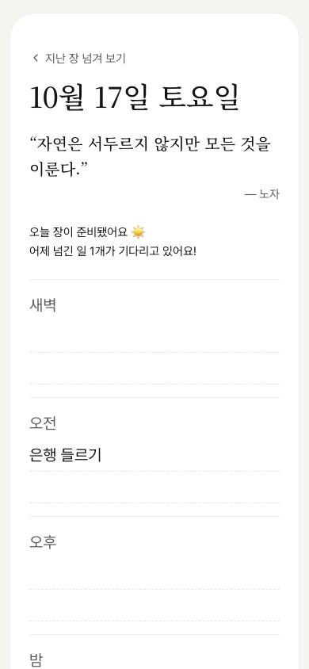
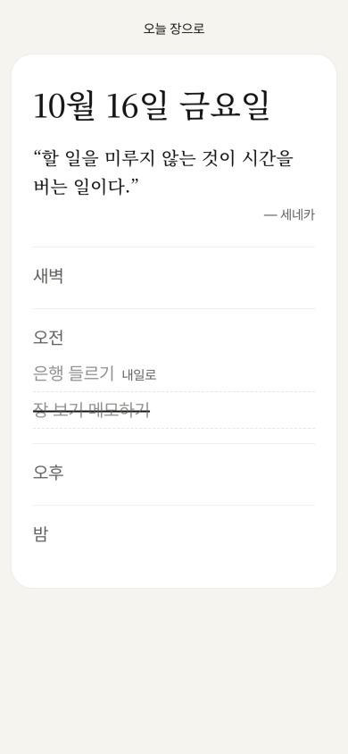
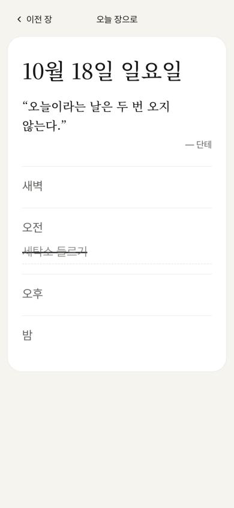
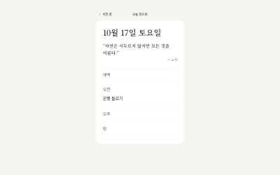

# Review — 04 · F4 지난 장 넘겨보기

> Vibe Studio · build-check · 최신 점검이 위에 있어요

## 2026-10-16 · 목표: UI 구현 · 걸어본 플로우: F4

**한 줄 결론:** 목표 순간까지 막힘 없이 가요. 막힘·어긋남·위험 없음.

> 만든 대화와 같은 대화에서 점검했어요. 새 대화에서 다시 부르면 더 깐깐하게 볼 수 있어요.

### 걸어본 길
폰 폭(390px), 브라우저 데이터를 지운 처음 상태. 16일 아침에 할 일 2개를 손으로 적고 하나를 그은 뒤, 밤에 남은 하나를 내일로 보냈어요. 17일 아침에 열어 지난 장을 넘겨 봤어요.

| 단계 | 화면 | 결과 | 스크린샷 |
|:--:|------|------|------|
| ① | 오늘 장 | 통과 — 날짜 위 [지난 장 넘겨 보기] |  |
| ② | 지난 장 | 통과 — 목표 순간 도착. 16일 장에 그은 줄 그대로, 보낸 일은 "내일로" |  |
| ② | 여러 장 넘기기 | 통과 — 펼친 장만 넘기고 끝에서는 화살표가 숨음 |  |
| — | 넓은 화면 (1280px) | 통과 — 가운데 폰 폭, 지난 장 카드 |  |

확인 기준 9개 중 9개 통과 · 콘솔 에러 없음(새 탭에서 확인) · 비밀 키 없음

함께 건드려 본 예외: 이 기기의 첫 장엔 링크 없음 · 펼치지 않은 날은 건너뜀 · 지난 장에서 새로고침하면 오늘 장 · 지난 장을 보다 자정이 지나 돌아오면 새 오늘 장 · 눌러도 길게 눌러도 바뀌지 않음 · 빈 지난 장 문구

### 문제
막힘·어긋남·위험 없음

### 다듬으면 좋을 것
- 손가락으로 밀어 넘기기는 첫 버전 범위 밖이라 없어요. 폰에서는 화살표 글씨가 조금 작게 느껴질 수 있어요(15px)

### 기획과 달라진 점 (→ userflow-generator)
- [지난 장 넘겨 보기]는 왼쪽 화살표가 붙은 작은 회색 글씨, [오늘 장으로]는 지난 장 카드 위 가운데 (LOG 조각 1)
- 빈 지난 장은 4칸을 그리지 않고 한 줄만 (LOG 조각 2)
- 장을 넘기면 맨 위로 스크롤 (LOG 조각 3)

### 다음
1. userflow-generator로 F4 상태 반영 — 지도의 네 플로우가 모두 만들어져요
